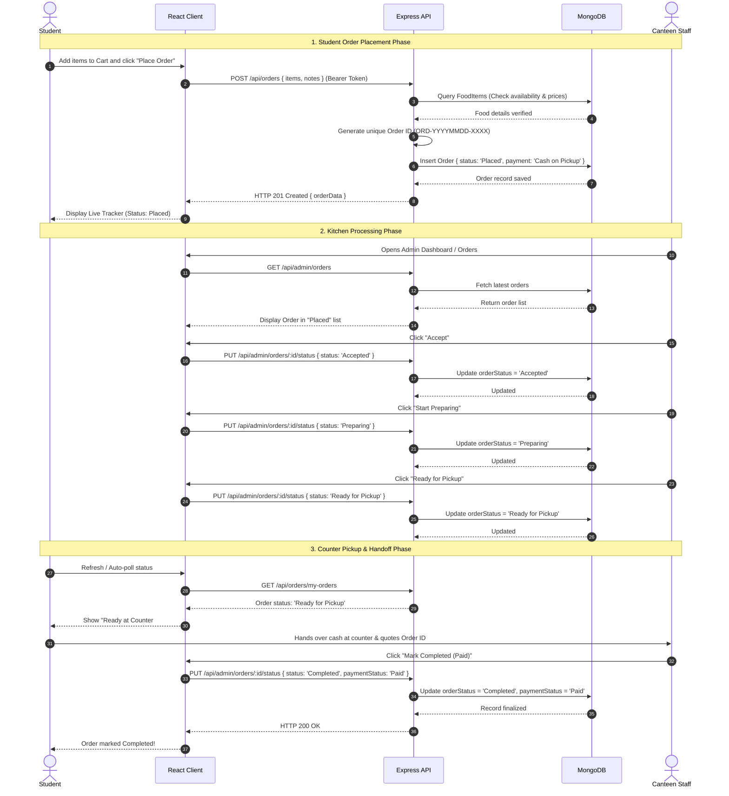

# System Architecture & Technical Design
## Campus Canteen Pre-Order Management System

---

### 1. High-Level Architecture Overview
The system employs a classic, robust 3-Tier Client-Server Architecture using the MERN stack (MongoDB, Express.js, React.js, Node.js). Communication between the presentation layer and application server is mediated exclusively via RESTful JSON APIs.

```mermaid
graph TD
    subgraph ClientLayer["Frontend Layer (React.js + Vite + Tailwind CSS)"]
        A[Student UI: Menu, Cart, Tracker, History]
        B[Admin UI: Dashboard, Menu CRUD, Orders Management]
        C[Context Layer: AuthContext, CartContext, API Interceptor]
    end

    subgraph ServerLayer["Backend Layer (Node.js + Express.js)"]
        D[Express Router & CORS Middleware]
        E[Security & Auth Middleware (JWT & bcrypt)]
        F[Controllers: Auth, Food, Order, Admin]
        G[Mongoose ODM Layer & Schema Validation]
    end

    subgraph DatabaseLayer["Data Persistence Layer (MongoDB)"]
        H[(User Collection)]
        I[(FoodItem Collection)]
        J[(Order Collection)]
    end

    A -->|REST API over HTTP/JSON| D
    B -->|REST API over HTTP/JSON| D
    D --> E
    E --> F
    F --> G
    G --> H
    G --> I
    G --> J
```

---

### 2. Module Breakdown

#### 2.1 Presentation Tier (`/client`)
- **Routing Engine (`react-router-dom`):** Declarative, client-side routing.
  - Role-gated `ProtectedRoute` wrappers prevent unauthorized access between students and canteen operators.
- **State Management:**
  - `AuthContext`: Maintains active user session, token in `localStorage`, and handles sign-in/registration lifecycle.
  - `CartContext`: Local, persistent store of cart items, unit pricing, item quantity adjustments, and computed grand totals.
- **API Communication (`axios`):** Unified axios service with request interceptors attaching `Authorization: Bearer <token>` automatically to protected endpoints.

#### 2.2 Application Tier (`/server`)
- **Express Server (`server.js`):** Lightweight web framework with CORS, JSON body parsers, and custom central error middleware.
- **Controllers:**
  - `authController.js`: Registration, login authentication, password hash checks, and JWT generation.
  - `foodController.js`: Full CRUD endpoints, search query compilation, and category filters.
  - `orderController.js`: Order verification, stock checking, order ID generation, cancellation guard.
  - `adminController.js`: Operational aggregation queries, revenue computation, and order stage transitions.
- **Middleware:**
  - `authMiddleware.js`: Token extraction and verification using `jsonwebtoken`.
  - `adminMiddleware.js`: RBAC guard ensuring `req.user.role === 'admin'`.
  - `errorHandler.js`: Formats Mongoose validation errors, duplicate keys, and 404 routes into clear JSON responses.

#### 2.3 Persistence Tier (`/server/models`)
- **Mongoose ODM:** Enforces strict typing, default values, references, and pre-save hooks (e.g., bcrypt password hashing).

---

### 3. End-to-End Sequence Diagram (Order Lifecycle)

The following sequence diagram illustrates the complete end-to-end lifecycle between the Student, the System, and the Canteen Admin:



---

### 4. Technology Stack & Justification

| Technology | Role | Justification for Academic Project |
|---|---|---|
| **React.js 18** | Frontend Library | Component-based, reactive UI, clean state model, widespread industry relevance. |
| **Vite** | Build Tool | Instant hot module replacement (HMR), rapid build execution, no Webpack overhead. |
| **Tailwind CSS** | Styling | Utility-first, highly responsive, zero separate CSS maintenance required. |
| **Node.js + Express** | Web Application Server | Non-blocking I/O, JavaScript across whole stack, lightweight REST routing. |
| **MongoDB + Mongoose** | Database & ODM | Flexible document schema ideal for nested order items; native JSON document mapping. |
| **JSON Web Tokens (JWT)** | Authentication | Stateless authorization; eliminates server-side session stores. |
| **bcryptjs** | Password Security | Pure-JavaScript salted hashing; zero native C++ compilation issues on Windows. |
| **Lucide React** | Iconography | Lightweight, tree-shakeable icons for clean status visuals and UI feedback. |
