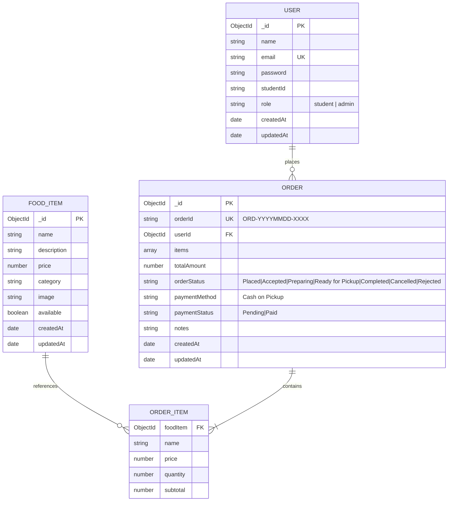

# Database Design & Data Dictionary
## Campus Canteen Pre-Order Management System

---

### 1. Database Architecture Overview
The database employs **MongoDB** with **Mongoose ODM**. It balances relational normalization (referencing `User` from `Order`) with document embedding (embedding `OrderItem` snapshots inside `Order`).

#### Architectural Decision: Why Embed `OrderItem` inside `Order`?
1. **Price Integrity Snapshot:** Food menu prices fluctuate over time. Embedding a price snapshot (`name`, `price`, `quantity`, `subtotal`) inside the order ensures past order totals never mutate retrospectively if a menu item's price is updated next semester.
2. **Atomic Reads & Writes:** An order and all its dishes are retrieved and saved in a single atomic database operation without requiring slow multi-collection `$lookup` joins.

---

### 2. Entity-Relationship (ER) Diagram

---

### 3. Collection Specifications

#### 3.1 `users` Collection
Stores registered students and canteen administrative staff.

| Field Name | BSON Type | Constraints | Description |
|---|---|---|---|
| `_id` | ObjectId | Primary Key | Auto-generated document ID |
| `name` | String | Required, Max 50 | User's full name |
| `email` | String | Required, Unique, Lowercase | Campus email address |
| `password` | String | Required, Min 6 | Salted bcrypt hash |
| `studentId` | String | Optional (for admin), Trimmed | Student roll / enrollment ID |
| `role` | String | Enum: `['student', 'admin']` | User permissions role (Default: `'student'`) |
| `createdAt` | Date | Timestamp | Account creation timestamp |
| `updatedAt` | Date | Timestamp | Last record modification timestamp |

#### 3.2 `fooditems` Collection
Stores the food dishes available at the canteen.

| Field Name | BSON Type | Constraints | Description |
|---|---|---|---|
| `_id` | ObjectId | Primary Key | Auto-generated document ID |
| `name` | String | Required, Max 100 | Food item title |
| `description`| String | Required, Max 500 | Ingredients and dish details |
| `price` | Number | Required, Min 0 | Price in Indian Rupees (₹) |
| `category` | String | Required, Trimmed | Categorization (Snacks, Meals, Beverages, etc.) |
| `image` | String | Optional | Image URL |
| `available` | Boolean | Default `true` | Stock availability flag |
| `createdAt` | Date | Timestamp | Dish creation timestamp |
| `updatedAt` | Date | Timestamp | Last update timestamp |

#### 3.3 `orders` Collection
Tracks pre-orders from placement to physical handoff at the counter.

| Field Name | BSON Type | Constraints | Description |
|---|---|---|---|
| `_id` | ObjectId | Primary Key | Auto-generated document ID |
| `orderId` | String | Required, Unique | Human-readable identifier (`ORD-YYYYMMDD-XXXX`) |
| `userId` | ObjectId | Required, Ref `User` | Student who placed the order |
| `items` | Array | Required, Min 1 item | Embedded array of `OrderItem` objects |
| `items.foodItem`| ObjectId | Required, Ref `FoodItem` | Original food item reference |
| `items.name` | String | Required | Historical snapshot of dish name |
| `items.price` | Number | Required, Min 0 | Historical snapshot of unit price |
| `items.quantity`| Number | Required, Min 1 | Quantity ordered |
| `items.subtotal`| Number | Required, Min 0 | `price * quantity` |
| `totalAmount`| Number | Required, Min 0 | Total price payable |
| `orderStatus`| String | Enum: 7 states | `Placed`, `Accepted`, `Preparing`, `Ready for Pickup`, `Completed`, `Cancelled`, `Rejected` |
| `paymentMethod`| String | Default `'Cash on Pickup'` | Payment mode |
| `paymentStatus`| String | Enum: `['Pending', 'Paid']`| Cash collection status |
| `notes` | String | Optional | Student preparation instructions |
| `createdAt` | Date | Timestamp | Order timestamp |
| `updatedAt` | Date | Timestamp | Last status update timestamp |

---

### 4. Indexing Strategy
1. `users.email`: Unique index for $O(1)$ fast lookups during login and ensuring no duplicate accounts.
2. `orders.orderId`: Unique index ensuring fast order tracking and counter reference.
3. `orders.userId`: Compound index on `(userId, createdAt: -1)` enabling instant retrieval of a student's past order ledger.
4. `fooditems.category`: Index for fast category filtering.
