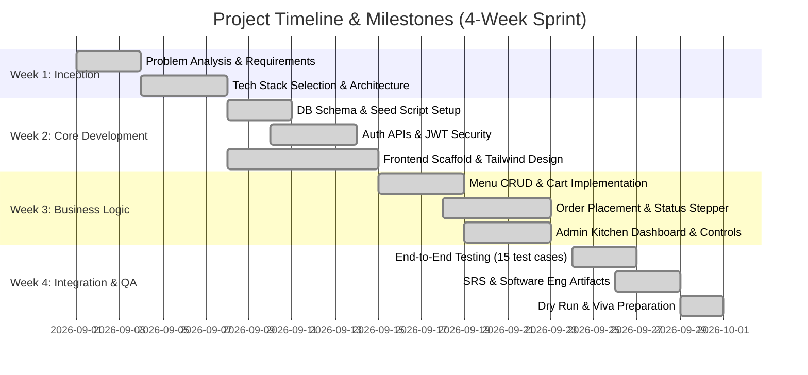

# Project Management Plan & Team Work Breakdown
## Campus Canteen Pre-Order Management System

---

### 1. Team Organization & Work Allocation (3-Member Team)

| Team Member | Role Focus | Primary Responsibilities |
|---|---|---|
| **Member 1** | **Frontend / Student Experience Lead** | - Responsive React UI using Vite & Tailwind CSS - Student Dashboard, Menu view, food detail modals, and Shopping Cart - Checkout workflow and live order-progress stepper - Student-side responsiveness and usability testing |
| **Member 2** | **Backend / API / Security Engineer** | - Node.js Express server architecture, routing, and error handling - JWT token generation, authentication middleware, and `bcryptjs` password hashing - Student and Admin RESTful endpoints, including order placement and status updates - API testing and frontend-backend integration support |
| **Member 3** | **Database, Admin, QA & Documentation Lead** | - MongoDB schema design (User, FoodItem, Order models) and seed scripts - Admin Dashboard, menu CRUD, availability controls, and order workflow state machine - End-to-end testing, documentation (SRS, architecture, use cases), and viva preparation - Repository hygiene and final integration review |

---

### 2. Work Breakdown Structure (WBS) & Milestones

---

### 3. Weekly Progress Tracking Template

| Week | Milestone / Deliverable | Target Date | Actual Completion | Reviewer Notes |
|---|---|---|---|---|
| **Week 1** | Project SRS, Architecture & Schema Finalization | Sept 07, 2026 | Completed | Approved by team |
| **Week 2** | User Auth (JWT), Database Models, Base UI Shell | Sept 14, 2026 | Completed | Auth verified via Postman |
| **Week 3** | Cart, Order APIs, Admin Kitchen Dashboard | Sept 21, 2026 | Completed | End-to-end order working |
| **Week 4** | Full Testing (15 test cases), Documentation, Viva Prep | Sept 30, 2026 | Completed | Ready for evaluation |

---

### 4. Meeting Log Template

#### Meeting 1: Architecture & Scope Alignment
- **Date:** September 02, 2026 | **Duration:** 45 mins
- **Attendees:** All Members (1, 2, 3)
- **Agenda:** Finalize tech stack and agree on scope (strictly no real payment gateway; use Cash on Pickup).
- **Outcomes:** Selected React + Vite for client, Express + MongoDB for backend.

#### Meeting 2: API Contract & Database Freezing
- **Date:** September 09, 2026 | **Duration:** 60 mins
- **Attendees:** Member 2 (Backend), Member 3 (DB), Member 1 (Frontend)
- **Agenda:** Define REST route names and JSON payload formats.
- **Outcomes:** Frozen `/api/auth`, `/api/food`, `/api/orders`, `/api/admin` schema contracts.

#### Meeting 3: End-to-End Workflow Verification
- **Date:** September 22, 2026 | **Duration:** 50 mins
- **Attendees:** All Members
- **Agenda:** Walk through student order placement and admin kitchen status transition.
- **Outcomes:** Verified live status updates; refined cancellation rules for `Placed` only.

---

### 5. Individual Contribution Record Template

| Team Member | Specific Files Contributed | Key Achievements |
|---|---|---|
| **Member 1 (Frontend)** | `client/src/pages/student/*`, `client/src/components/FoodCard.jsx`, `client/src/context/CartContext.jsx` | Designed the student ordering interface, responsive cart, checkout flow, and visual live-progress stepper. |
| **Member 2 (Backend/API)** | `server/server.js`, `server/controllers/authController.js`, `server/controllers/orderController.js`, `server/middleware/*`, `server/routes/*` | Built JWT authentication, password hashing, protected APIs, order processing, and server-side error handling. |
| **Member 3 (Database/Admin/QA)** | `server/models/*`, `server/controllers/adminController.js`, `server/seed/seed.js`, `client/src/pages/admin/*`, `docs/*`, `README.md` | Created database schemas and seed data, admin kitchen controls, test documentation, system artifacts, and final integration checks. |
