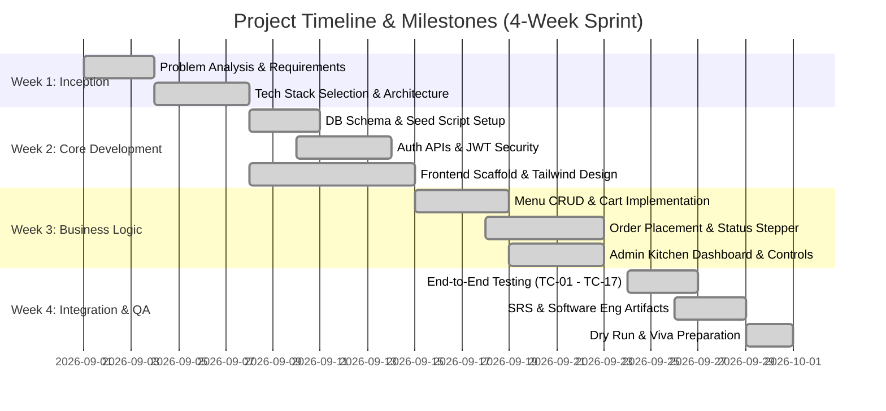

# Project Management Plan & Team Work Breakdown
## Campus Canteen Pre-Order Management System

---

### 1. Team Organization & Work Allocation (4-Member Team)

| Team Member | Role Focus | Primary Responsibilities |
|---|---|---|
| **Member 1** | **Frontend / Student UI Specialist** | - Responsive React UI using Vite & Tailwind CSS - Student Dashboard, Menu view, and Food detail modals - Shopping Cart management and Checkout workflow - Live Order progress tracker with visual stepper |
| **Member 2** | **Backend / API / Security Engineer** | - Node.js Express server architecture and routing - JWT token generation and authentication middleware - Password salting and hashing with `bcryptjs` - Student and Admin RESTful endpoints and error handling |
| **Member 3** | **Database & Admin Operations Lead** | - MongoDB schema design (User, FoodItem, Order models) - Admin Dashboard metrics and operational aggregations - Menu Item CRUD and instant availability toggling - Order workflow status state machine and seed scripts |
| **Member 4** | **QA, Documentation & Integration Lead** | - Black-box testing and Test Case ledger creation - Software Engineering documentation (SRS, Architecture, Use Cases) - API testing and cross-browser responsiveness checks - Viva presentation preparation and repository hygiene |

---

### 2. Work Breakdown Structure (WBS) & Milestones

---

### 3. Weekly Progress Tracking Template

| Week | Milestone / Deliverable | Target Date | Actual Completion | Reviewer Notes |
|---|---|---|---|---|
| **Week 1** | Project SRS, Architecture & Schema Finalization | Sept 07, 2026 | Completed | Approved by team |
| **Week 2** | User Auth (JWT), Database Models, Base UI Shell | Sept 14, 2026 | Completed | Auth verified via Postman |
| **Week 3** | Cart, Order APIs, Admin Kitchen Dashboard | Sept 21, 2026 | Completed | End-to-end order working |
| **Week 4** | Full Testing (17 test cases), Documentation, Viva Prep | Sept 30, 2026 | Completed | Ready for evaluation |

---

### 4. Meeting Log Template

#### Meeting 1: Architecture & Scope Alignment
- **Date:** September 02, 2026 | **Duration:** 45 mins
- **Attendees:** All Members (1, 2, 3, 4)
- **Agenda:** Finalize tech stack and agree on scope (strictly no real payment gateway; use Cash on Pickup).
- **Outcomes:** Selected React + Vite for client, Express + MongoDB for backend.

#### Meeting 2: API Contract & Database Freezing
- **Date:** September 09, 2026 | **Duration:** 60 mins
- **Attendees:** Member 2 (Backend), Member 3 (DB), Member 1 (Frontend)
- **Agenda:** Define REST route names and JSON payload formats.
- **Outcomes:** Frozen `/api/auth`, `/api/food`, `/api/orders`, `/api/admin` schema contracts.

#### Meeting 3: End-to-End Workflow Verification
- **Date:** September 22, 2026 | **Duration:** 50 mins
- **Attendees:** All Members
- **Agenda:** Walk through student order placement and admin kitchen status transition.
- **Outcomes:** Verified live status updates; refined cancellation rules for `Placed` only.

---

### 5. Individual Contribution Record Template

| Team Member | Specific Files Contributed | Key Achievements |
|---|---|---|
| **Member 1 (Frontend)** | `client/src/pages/student/*`, `client/src/components/FoodCard.jsx`, `CartContext.jsx` | Designed clean student ordering interface, responsive cart, and visual live progress stepper. |
| **Member 2 (Backend)** | `server/server.js`, `controllers/authController.js`, `middleware/*`, `routes/authRoutes.js` | Built robust JWT authentication, bcrypt password hashing, and role verification guards. |
| **Member 3 (Database/Admin)** | `models/*`, `controllers/adminController.js`, `seed/seed.js`, `pages/admin/*` | Created Mongoose schemas, seed scripts, admin kitchen dashboard, and status change workflow. |
| **Member 4 (QA/Docs)** | `docs/*`, `README.md`, `tests`, `controllers/orderController.js` verification | Formulated 17 black-box test cases, SRS, architecture specs, and viva demo verification. |
